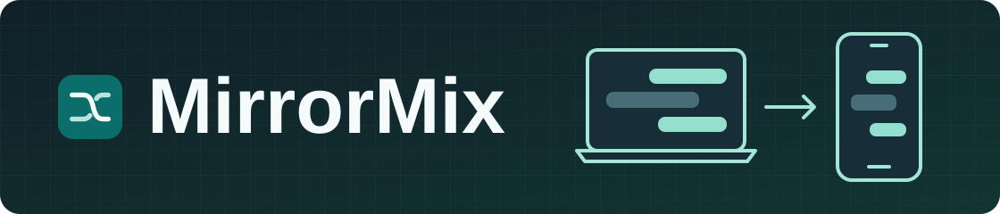
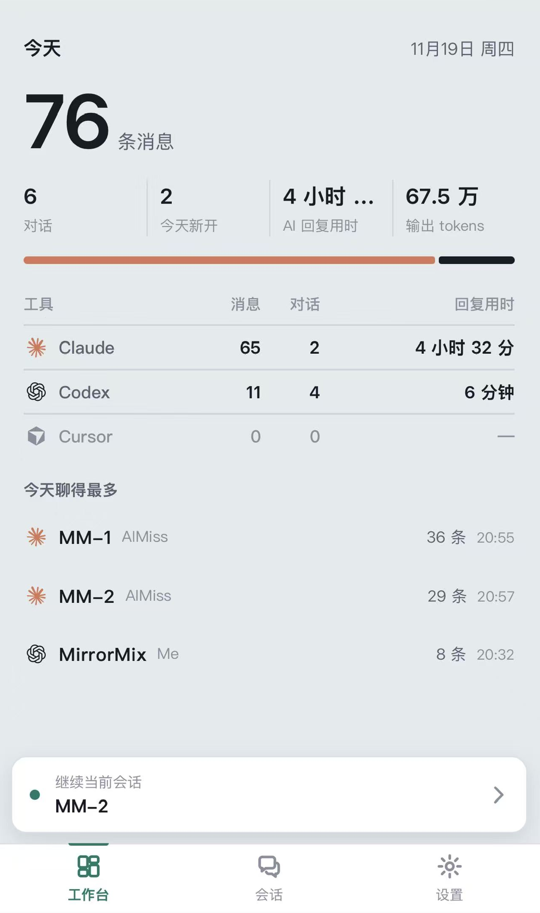
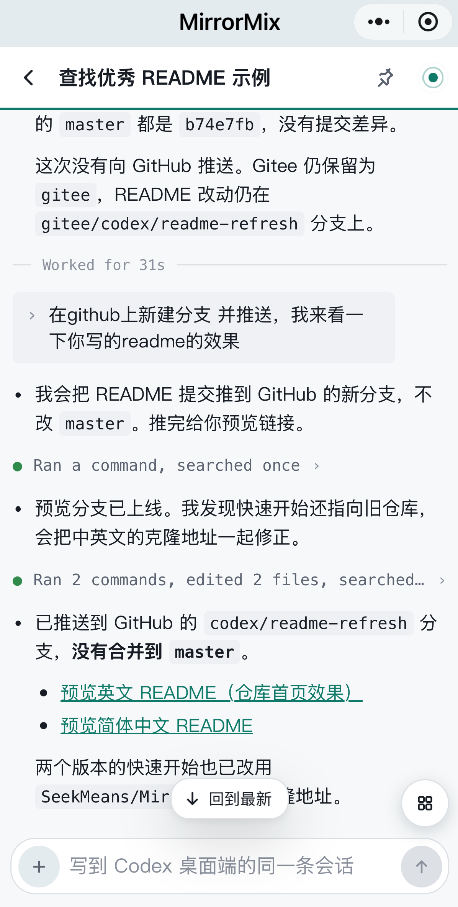

# Keep coding and deploying away from your desk

MirrorMix gives you access to your PC's development workspace from your phone. Start a task in Codex before you leave, check its progress and send a follow-up on the go, or run a deployment task you've already set up.

<p align="center">
  <a href="LICENSE"></a>
  
</p>

<p align="center">
  <strong>English</strong> · <a href="README.zh-CN.md">简体中文</a>
</p>

<p align="center">
  <a href="#what-you-can-do-from-your-phone">What you can do</a> ·
  <a href="#connect-your-phone">Connect your phone</a> ·
  <a href="#download">Download</a> ·
  <a href="#run-from-source">Run from source</a>
</p>

## What you can do from your phone

- **Pick up an existing chat.** Read replies and send your next message in a Claude Code, Codex, or Cursor session that's already on your PC.
- **Manage your servers.** Use the built-in SSH terminal to check logs and run commands on a configured server. Upload or download files with SFTP.
- **Run repeatable maintenance and deployments.** Save a script and its target server as a task, such as updating a test environment or restarting a service. Tap **Run** on your phone and see the status and output without retyping commands.

<p align="center">
  <a href="docs/mobile-dashboard.png"></a>
  <a href="docs/mobile-session.png"></a>
</p>
<p align="center"><sub>Left: mobile workspace · Right: Codex session (select either image to enlarge)</sub></p>

## Connect your phone

Start MirrorMix on your Windows PC, then choose how to reach it from your phone:

- **Have a cloud server? Run your own tunnel.** Use your server to relay traffic from an HTTPS address to MirrorMix on your Windows PC. No mini program application is needed.
- **No cloud server? Request a port in the MirrorMix mini program.** Once approved, it shows a subdomain and a connection token. In MirrorMix on your PC, go to **Settings → General → Remote access**, enter both, save, and wait for **Connected**.

Open your **HTTPS address** in your phone browser and sign in with the PC's Windows account. Open an existing chat, or go to **Plugins → SSH** to work on a server.

<details>
<summary>Self-hosted tunnel setup notes</summary>

For example, run frps on your cloud server and point frpc on Windows at the local service on `127.0.0.1:4789`. Put an HTTPS reverse proxy on the cloud server, support WebSockets, and preserve the original `Host` (or pass the correct `X-Forwarded-Host`). If your proxy rewrites the host and doesn't forward the original, set `MIRRORMIX_ALLOWED_ORIGINS` to your browser-facing origin, such as `https://mm.example.com`, before starting MirrorMix.

Do not expose the forwarded MirrorMix port directly to the internet. Use the HTTPS entry point and keep sign-in enabled.

</details>

**Before you leave:** Keep the PC on, online, and running MirrorMix. Keep sign-in enabled for remote access, and don't expose the local service directly to the internet.

## Download

**The one-click Windows build is not available yet.** The goal is simple: download, double-click to launch, and open MirrorMix in your browser. No separate Node.js install or terminal commands. Phone access still needs the setup above.

## Run from source

<details>
<summary>Expand: for developers and early testers</summary>

On Windows with **Git and Node.js 22+**, open PowerShell and run:

```powershell
git clone https://github.com/SeekMeans/MirrorMix.git
cd MirrorMix
npm install
npm start
```

`npm start` builds the client and starts the server. Open <http://127.0.0.1:4789> in your browser, then select an existing session.

### Advanced features

- Read Codex JSONL transcripts and paginated SQLite history, and display project names from the Codex desktop sidebar.
- Send through the desktop window when available, with CLI or queue fallback paths depending on the tool and connection mode.
- Open shared project terminals, run shortcuts and local command tasks, and view schedules created in Claude and Codex.
- Start, stop, or restart named services from the project terminal.
- Optionally reach MirrorMix through your own tunnel or reverse proxy while keeping the app bound to localhost.

### Development

Development (server hot-reload):

```powershell
npm run dev
```

After client UI changes, run `npm run build` from the project root (Vite `outDir` is `dist/`, which the server serves), or use `npm start` again.

Change the port:

```powershell
$env:AIMISS_PORT = "4790"
npm run dev
```

Stop with Ctrl+C in the terminal that started it. If that terminal is gone:

```powershell
$conn = Get-NetTCPConnection -LocalPort 4789 -State Listen -ErrorAction SilentlyContinue | Select-Object -First 1
if ($conn) { Stop-Process -Id $conn.OwningProcess }
```

### Connection mode

Unset defaults to `legacy` (original Codex CLI resume/create and Claude inbox / desktop follow / CLI takeover paths). Cursor behavior is unchanged either way.

For Codex and Claude to send through the desktop apps instead, set before start:

```powershell
$env:AIMISS_CONNECTION_MODE = "desktop"
```

Or write `%USERPROFILE%\.mirrormix\connection-mode.json`:

```json
{ "mode": "desktop" }
```

Environment variables win over the file. That file lives outside the repo.

In `desktop` mode the web UI drives the desktop session input via Windows UI Automation and syncs replies from local history. The matching desktop app must be open and signed in. Sessions are matched by full title; open the chat in the desktop app first if it is missing from the sidebar.

### Security

MirrorMix listens on **`127.0.0.1` only**. Do not bind it to `0.0.0.0`. It can send into Claude/Codex/Cursor and open shells in your project folders—exposing it on the public internet is equivalent to handing over the machine.

To use it from a phone or another PC, put a reverse proxy or tunnel in front of `127.0.0.1:4789`, and:

- Serve the outside with **HTTPS** (login uses the Windows account)
- Prefer an extra gate (Tailscale, proxy auth, Cloudflare Access, etc.)
- Keep MirrorMix login enabled; use a strong Windows password

#### Tailscale (simple)

```powershell
tailscale serve --bg 4789
```

Open `https://<machine>.<tailnet>.ts.net` from your phone on the same Tailscale account.

### Config tips

| Item | Where |
|---|---|
| Port | `AIMISS_PORT` (default `4789`) |
| Connection mode | `AIMISS_CONNECTION_MODE` or `~\.mirrormix\connection-mode.json` |
| Global shortcuts | `~\.mirrormix\commands.json` (or `AIMISS_COMMANDS`) |
| Remote / tunnel settings | `~\.mirrormix\` and optional `mirrormix.config.json` / `MIRRORMIX_CONFIG` |

Pinned chats, quotas, and most “how do I …” details are in the in-app Help page.

</details>

## License

[MIT](LICENSE) © tnndworlds
