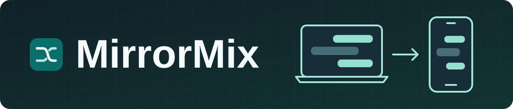
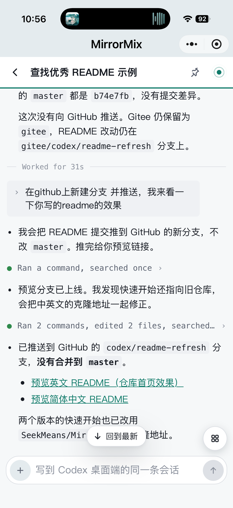

  
  
   
  <a href="README.md">English</a> · <strong>简体中文</strong>

[概览](#概览) · [核心功能](#核心功能) · [插件扩展](#插件扩展) · [安装与访问](#安装与访问)

## 概览

**MirrorMix 是一个可以从电脑用到手机的 AI 工作台。** 它运行在你的 Windows 电脑上：在电脑浏览器里统一看多个 AI 工具的进度，离开电脑后，用手机继续原来的工作。

- **多个 AI 工具，一个状态看板。** 把 Claude Code、Codex 和 Cursor 的已有会话集中起来，一眼看清谁还在回复、哪条有新结果，点开就能接着聊，不用来回切换桌面应用。
- **换设备，不换会话。** 在电脑上发起任务，在手机上看进度、补充要求、查看生成的文件或网页。实际工作仍由电脑上的工具完成，手机不用再安装一套 AI 工具。

不写代码也能用：在电脑上让 AI 起草活动方案或周报，路上用手机看初稿、补一句修改意见，回到电脑继续整理。

## 核心功能

| 功能 | 电脑端 | 手机端 |
| --- | --- | --- |
| **状态看板** | 集中查看各工具正在回复、回复完还没看的会话。 | 随时看待处理的回复，工作台还会汇总当天的会话和消息。 |
| **会话接续** | 按工具或项目找到已有会话，打开就能继续。 | 接着同一条会话读回复、补充要求，不用再解释一遍背景。 |
| **查看创作内容** | 预览 AI 生成的草稿、图片、PDF 或网页。 | 在外面快速看方案或页面效果，直接回到原会话提修改意见。 |
| **资源管理器** | 在会话内打开对应文件夹，浏览文件树、预览或下载文件。 | 进入同一个文件夹，点文件全屏预览，不用先把文件发到手机。 |

  
  

左：手机工作台 · 右：继续原会话（点击查看大图）

## 插件扩展

在「插件」里按需添加功能。日常写作和查资料不需要开这些插件；需要运行命令、管理服务器时，再把它们加进工作台。

- **项目终端和快捷命令。** 可在会话旁打开项目终端。要复用常用操作，可以保存快捷命令，或使用「命令任务」插件。
- **远程管理服务器。** 在「SSH 连接」插件里连接已配置的服务器，查日志、执行命令，或用 SFTP 上传和下载文件。
- **一键运行运维和部署任务。** 在 SSH 插件里把脚本和目标服务器存成任务，例如更新测试环境或重启服务。之后在电脑或手机上点击「执行」，就能查看状态和输出。

**一起做插件：** 欢迎自行开发插件，通过 [Issues](https://github.com/SeekMeans/MirrorMix/issues) 提议功能，或提 PR 参与维护。当前插件随 MirrorMix 一起发布；第三方插件的独立安装暂未开放。

## 安装与访问

### 1. Windows 安装

1. 拿到 Windows 安装包后，双击打开 Setup 安装程序，按提示完成安装。
2. 从开始菜单打开 MirrorMix，在托盘控制面板点「启动」。浏览器会打开工作台，默认地址是 <http://127.0.0.1:4789>。
3. 在电脑上安装并登录你要使用的 AI 工具，再到 MirrorMix 打开已有会话。

安装包不用克隆仓库或手敲构建命令，但当前需要电脑已安装 **Node.js 22 或以上版本**，安装包暂未内置。公开下载请留意 [GitHub Releases](https://github.com/SeekMeans/MirrorMix/releases)。

### 2. 外网访问：让手机打开工作台

- **没有云主机：** 在 MirrorMix 小程序申请访问地址，或在电脑端「设置 → 外网访问」里申请。审核通过并绑定电脑后，设置访问密码并开启外网访问。看到「已连接」后，复制 HTTPS 地址到手机浏览器，用刚设置的密码登录。
- **有自己的云主机：** 可以自建内网穿透，不用申请。用 HTTPS 入口转发到运行 MirrorMix 的电脑，并配置访问控制；不要直接把本机端口暴露到公网。

手机连的是同一台电脑。离开前请让电脑保持开机、联网，并让 MirrorMix 继续运行。

### 3. 在浏览器里打开生成的网页

如果 AI 生成了 HTML 页面，或项目已经在电脑上运行，点会话旁的**地球图标**，选择要预览的网页文件或本机服务，即可在新标签页打开。使用 MirrorMix 自带的外网访问时，也可以在手机上打开这个预览。预览链接是临时的，不是可以长期分享的公开网址。

### 4. 全屏使用

- **电脑：** 打开工作台或生成的网页，在支持的浏览器里按 `F11` 进入／退出全屏。
- **手机：** 在资源管理器点文件即可全屏预览；想快速回到工作台，也可以用浏览器的「添加到主屏幕」（如支持）。

从源码运行（开发者）

在装有 Git 和 Node.js 22+ 的 Windows 上打开 PowerShell：

~~~powershell
git clone https://github.com/SeekMeans/MirrorMix.git
cd MirrorMix
npm install
npm start
~~~

打开 <http://127.0.0.1:4789>。开发时可用 `npm run dev` 启动带热更新的服务。更多操作见应用内「帮助」。

[MIT 许可证](LICENSE) © tnndworlds
