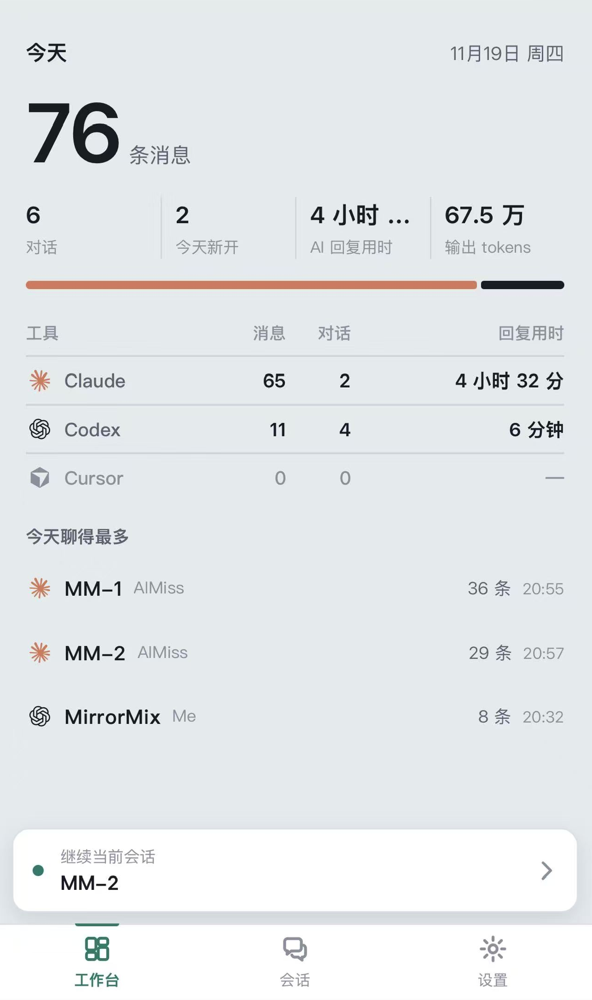

# 不在电脑前，也能继续开发和部署

MirrorMix 把你电脑上的开发工作台带到手机。出门前让 Codex 开始改代码，路上用手机看进度、接着发消息；需要发版时，也能从手机运行已经配置好的部署任务。

<p align="center">
  <a href="LICENSE"></a>
  
</p>

<p align="center">
  <a href="README.md">English</a> · <strong>简体中文</strong>
</p>

<p align="center">
  <a href="#手机上能做什么">手机上能做什么</a> ·
  <a href="#怎么连上手机">怎么连上手机</a> ·
  <a href="#下载">下载</a> ·
  <a href="#从源码运行">从源码运行</a>
</p>

## 手机上能做什么

- **接着聊，不用重开。** 打开电脑上已有的 Claude Code、Codex 或 Cursor 会话，读回复、发下一条消息。
- **远程管理服务器。** 用内置的 SSH 终端连接已配置的服务器，查日志、执行命令，也能通过 SFTP 上传或下载文件。
- **一键跑运维和部署任务。** 把常用脚本和目标服务器存成任务，例如更新测试环境或重启服务。之后在手机上点「执行」，就能看到状态和输出，不用再手敲一遍命令。

<p align="center">
  <a href="docs/mobile-dashboard.png"></a>
  <a href="docs/mobile-session.png"></a>
</p>
<p align="center"><sub>左：手机工作台 · 右：继续 Codex 会话（点击查看大图）</sub></p>

## 怎么连上手机

先在 Windows 电脑上运行 MirrorMix，再选一种方式开通手机访问：

- **有云主机：自己搭内网穿透。** 用自己的云主机做中转，将 HTTPS 地址转发到 Windows 电脑上的 MirrorMix。无需向小程序申请。
- **没有云主机：用小程序申请端口。** 审核通过后，小程序会显示子域名和连接口令。在电脑端 MirrorMix 打开「设置 → 通用设置 → 外网访问」，填入这两项并保存，等待显示「已连接」。

开通后，用手机浏览器打开对应的 **HTTPS 地址**，用这台电脑的 Windows 账户登录。想继续聊，就点开已有会话；想操作服务器，就打开「插件 → SSH 连接」。

<details>
<summary>自建内网穿透的配置要点</summary>

例如用 frp：在云主机上运行 frps，Windows 上的 frpc 转发到本机的 `127.0.0.1:4789`。在云主机上用 HTTPS 反向代理作为入口，支持 WebSocket，并保留原始 `Host`（或传递正确的 `X-Forwarded-Host`）。如果代理改写了主机名且未转发原始主机名，在启动 MirrorMix 前设置 `MIRRORMIX_ALLOWED_ORIGINS` 为实际访问的地址，例如 `https://mm.example.com`。

不要对公网开放转发后的 MirrorMix 端口；通过 HTTPS 入口访问，并保留登录保护。

</details>

**出门前记得：** 让电脑保持开机、联网，并让 MirrorMix 继续运行。外网访问请保留登录保护，不要把本地服务直接暴露到公网。

## 下载

**Windows 一键运行版尚未发布。** 发布后的目标是：下载 → 双击启动 → 打开浏览器。不用单独安装 Node.js，也不用敲命令。手机访问仍需完成上面的开通步骤。

## 从源码运行

<details>
<summary>展开：仅供开发者和想提前试用的用户</summary>

在装有 **Git 和 Node.js 22+** 的 Windows 上打开 PowerShell：

```powershell
git clone https://github.com/SeekMeans/MirrorMix.git
cd MirrorMix
npm install
npm start
```

`npm start` 会先构建页面，再启动服务。用浏览器打开 <http://127.0.0.1:4789>，选一个已有会话就能接着聊。

### 进阶功能

- 读取 Codex JSONL 和分页 SQLite 历史，显示 Codex 桌面侧栏的项目名称；自定义分区里的项目也会平铺显示。
- 可用时通过桌面窗口发送；根据工具和通信模式，也可走 CLI 或队列等后备路径。
- 按工作区共享项目终端，支持全局快捷命令和本机命令任务。可查看在 Claude 和 Codex 里创建的定时任务。
- 在项目终端识别或配置服务启动命令，单独或批量启动、停止、重启。
- 可选：经你自己的隧道或反向代理远程访问，应用本身仍只监听本机。

### 开发

开发模式（服务端热更新）：

```powershell
npm run dev
```

改了前端后，请在项目根目录执行 `npm run build`（Vite 输出到根目录 `dist/`，由服务端提供），或再跑一次 `npm start`。

换端口：

```powershell
$env:AIMISS_PORT = "4790"
npm run dev
```

在启动它的终端里按 Ctrl+C 停止。终端已经不在时：

```powershell
$conn = Get-NetTCPConnection -LocalPort 4789 -State Listen -ErrorAction SilentlyContinue | Select-Object -First 1
if ($conn) { Stop-Process -Id $conn.OwningProcess }
```

### 通信模式

未配置时默认 `legacy`：保留原有 Codex CLI 恢复/新建，以及 Claude 输入通道、桌面跟随和 CLI 接管。Cursor 的通信方式两种模式都不变。

需要 Codex、Claude 都经桌面端收发时，启动前设置：

```powershell
$env:AIMISS_CONNECTION_MODE = "desktop"
```

或在本机写入 `%USERPROFILE%\.mirrormix\connection-mode.json`：

```json
{ "mode": "desktop" }
```

环境变量优先于文件。配置文件在仓库外，不会随 Git 提交。

`desktop` 模式下，网页通过 Windows UI Automation 操作桌面端输入框并同步本地历史。对应桌面应用需已打开并登录；按完整会话标题匹配，侧栏没有时请先在桌面端点开。

### 安全

MirrorMix **只监听 `127.0.0.1`**，不要改成 `0.0.0.0`。它能往 Claude / Codex / Cursor 发指令，也能在工作目录打开命令行——直接挂到公网等于交出这台电脑。

从手机或其它电脑访问时，在本机前面放反向代理或隧道，转发到 `127.0.0.1:4789`，并做到：

- 外面用 **HTTPS**（登录用的是 Windows 账号）
- 最好再加一道门（Tailscale、代理密码、Cloudflare Access 等）
- 不要关掉登录；Windows 账户用足够强的密码

#### Tailscale（推荐自用）

```powershell
tailscale serve --bg 4789
```

同一 Tailscale 账号下，手机打开 `https://电脑名.你的tailnet名.ts.net`。

### 配置一览

| 项 | 位置 |
|---|---|
| 端口 | `AIMISS_PORT`（默认 `4789`） |
| 通信模式 | `AIMISS_CONNECTION_MODE` 或 `~\.mirrormix\connection-mode.json` |
| 全局快捷命令 | `~\.mirrormix\commands.json`（或 `AIMISS_COMMANDS`） |
| 外网 / 隧道 | `~\.mirrormix\`，以及可选的 `mirrormix.config.json` / `MIRRORMIX_CONFIG` |

置顶会话、额度、操作细节见应用内「帮助」。

</details>

## 许可证

[MIT](LICENSE) © tnndworlds
